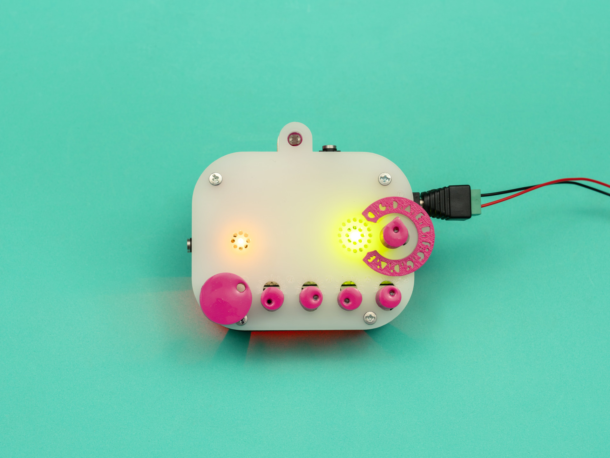

# Auduina MK2

A handmade multisensitive granular synthesizer, designed and built by [Los Aparatos](https://losaparatos.com.ar) in Tucumán, Argentina.

## What is it?

Auduina MK2 is a pentatonic granular synthesizer that responds to light, touch and voltage — instead of relying only on knobs, it reacts to gesture and environment, turning the space around it into part of the instrument. Its pentatonic tuning keeps it playable even without formal music background.

Featured on [Create Digital Music (CDM)](cdm.link/los-aparatos/).

## Repository contents

- `/schematics` — circuit schematics
- `/firmware` — source code for the onboard microcontroller
- `/images` — photos of the finished instrument

## About Los Aparatos

## About Los Aparatos

Los Aparatos is an electronic design studio building experimental musical instruments — synthesizers, sound toys and DIY kits — handmade in Tucumán, Argentina, since 2007.

Other instruments: Drawdio (a sound pencil that turns drawing into sound), CoyuyoC (a drone synth), Theremingo (an analog theremin).

## Where to buy

[losaparatos.com.ar](https://losaparatos.com.ar) · [Tindie](https://www.tindie.com/stores/mateoaparato/) · [Etsy](https://losaparatos.etsy.com) · [Reverb](https://reverb.com/shop/los-aparatos)

## License

[CC BY-NC-SA 4.0](https://creativecommons.org/licenses/by-nc-sa/4.0/)